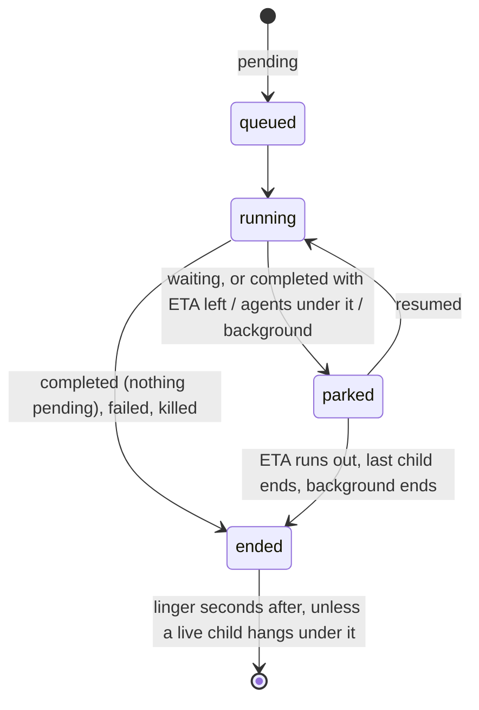

# SM1 A subagent's status, one phase off one function

## Now

`$.agent.list()` gives an `AgentStatus` string. `taskStatus`
(`subagent_tasks.ts:142`) maps `idle` to `completed`, and an agent the
list has let go is `completed` too (`subagent_tasks.ts:173`, `:222`). From
there `task.status` travels as a `string` inside `TreeTask.task: Dict`,
and each reader decides for itself whether the agent is live:

| Where (`master`) | Asks | Answer |
| --- | --- | --- |
| `band_tree.ts` (`forestOf`, for `drawnAgents` and `pruneFolds`) | fold kept? | drawn: not `ended`, ended under linger, or over a drawn agent |
| `band_tree.ts:457` (`ended`) | ended? | `failed`, `killed`, or `completed` and not parked |
| `band_tree.ts:751` (`groupNode`) | clock still running? | `running` or `waiting` |
| `claude_subagent_render.ts:699` (`agentCells`) | clock still running? | `running` or parked |
| `claude_subagent_render.ts:417` (`parked`) | paused? | `waiting`, or `completed` with ETA left, agents under it or background |
| `claude_subagent_render.ts:216` (`agentState`) | phase and mode marks | its own ladder, `pending` → queued |
| `claude_subagent_render.ts:438` (`runningParents`) | still to finish? | `running` or `pending` |
| `claude_subagent_render.ts:317` (`backgroundCount`) | background stopped? | `failed`, `killed` |
| `subagent_tasks.ts:175` (`inboxTargets`) | inbox counted? | not `killed`, `failed` |
| `agent_message.ts:61` (`LIVE`) | live sender? | `pending`, `running`, `waiting`, `idle` (raw, before the map) |
| `claude_render.ts:357` (`etaReading`) | clock stops at end? | `killed`, `failed` |

Eleven places, five different answers to "is it live". `TASK_ENDED`
(`claude_records.ts:783`) has `stopped` in it too, but that is a
background task's TaskOutput, another machine.

## Problems

- **A parked agent's group clock stops.** `groupNode`'s `live` is
  `running || waiting`, `agentCells`' is `running || parked`: a
  `completed` agent parked on an ETA is live on its own row and ended in
  its group's ⌛. Kept as is here; listed under SM1b.
- `status` is untyped: a typo is a new state, drawn in amber
  (`phaseSpan`).

## Target

- `type AgentStatus = "pending" | "running" | "waiting" | "completed" |
  "failed" | "killed"`, decoded once from the list (RF3), `idle` and
  "gone from the list" mapped there.
- `type AgentPhase = { kind: "queued" } | { kind: "running"; mode } |
  { kind: "parked"; why: "held" | "eta" | "agents" | "bash" | "monitor"
  } | { kind: "ended"; how: "done" | "failed" | "killed" | "api-error" }`.
- `agentPhase(status, usage, waitingOn): AgentPhase`, the one function;
  `agentState`'s marks, `parked`, `ended`, `runningParents`,
  `backgroundCount`, `inboxTargets` and the clocks read the phase.
  Where today's answers differ, each caller keeps its own answer through
  a named predicate on the phase (`clockRuns`, `foldKept`, …), so the
  output is unchanged and the differences are visible in one file.

## Tests

`agent_row.test.ts` gains the table: every `AgentStatus` × ETA (none,
time left, 0, overdue) × `waitingOn` × background (none, bash, monitor) ×
`api_error`, → phase and marks. The existing `band_tree.test.ts`,
`rows.test.ts` and the row cases stay byte-identical.

## Waits for

`UX20` and `TF4` (f1dd6e8, 396eaad): they move `agentState`, `parked`
and `runningParents` into `agent_row.ts` and delete
`claude_subagent_render.ts` and `claude_render.ts`.
