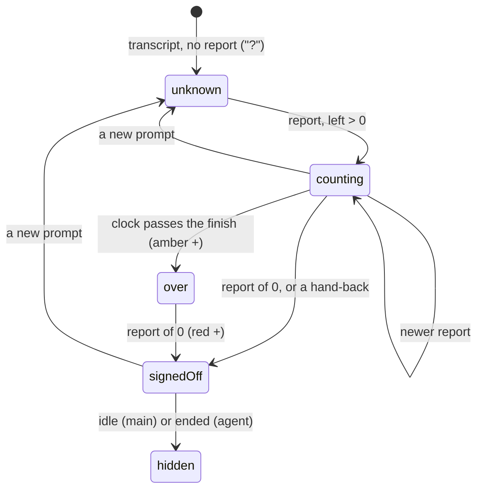

# SM8 An ETA's reading as one union, signed off in one place

## Now

An ETA report is `[epoch, seconds left]`, held as `number[]`, with `[]`
for "no report" and `null` for "no transcript"; `AgentEta`
(`claude_records.ts:2131`) is a third tuple. What ⛳ shows follows from it:

An agent's live report pushes its parent's out (`inheritEta`,
`claude_render.ts:387`) while it has written within `ETA_LIVE_S`
(1,800 s, `:374`).

- "Signed off" is computed three times: `band.ts:252` (main thread),
  `claude_subagent_render.ts:716` (agent), `claude_render.ts:447`
  (status line, removed by `TF4`).
- `etaReading` (`claude_render.ts:351`) returns `null | [] | [share,
  left]`, and every caller tests `got === null || !got.length`.
- The killed-or-failed clock stop (`:357`) reads `status` as a string
  (SM1).

## Target

- `type EtaReport = { at: number; left: number }`, `null` for none; the
  saved folds keep their arrays through SM2's codec.
- `etaShown(own, inherited, start, now, phase): { kind: "none" } | {
  kind: "unknown" } | { kind: "counting"; share; left } | { kind: "over";
  by; signedOff } | { kind: "hidden" }`, the one place signed-off and
  hidden are decided; the ⛳ cell draws from it.

## Tests

A table over (report, inherited, phase, now) → shown, one row per arrow
above. `cells.json` and the row cases unchanged.

## Waits for

`TF4`, which removes the status line's copy and moves `etaReading` into
the cells, and SM1 for the agent's phase.
