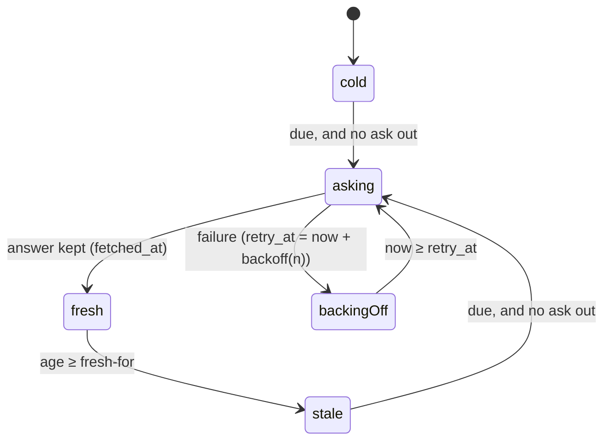

# SM6 A reading fetched with backoff, one machine for every source

## Now

Three sources keep a reading in the store and ask again on a pace, each
with its own fields and its own arithmetic:

| Source | Kept fields | Due when | Backoff |
| --- | --- | --- | --- |
| Plan usage (`hooks/plan_usage.ts`) | `reading`, `fetched_at`, `retry_at`, `failures` | `:127`, `:167` | `backoffAfter` `:64`: 120 s × 2ⁿ⁻¹, at most 3,600, or `Retry-After` |
| Native, tracker, OAuth (`src/sources.ts`) | `fetched_at`, `attempted_at`, `retry_at`, `fail_count` | `refreshDue` `:631` | `failureCache` `:640`: 2ⁿ s, at most 300 |
| Credits (`hooks/usage.ts`) | `attempted_at` | `:254` | none: every `CREDITS_TTL` |

The test "kept within `s` seconds of `now`, and not in the future",
`now - at < s && now >= at`, is written at `plan_usage.ts:128`, `:137`,
`:145`, `:168` and `usage.ts:254`; the "ask out" flag is `plan.asking`
(`:78`) and `creditsAsking` (`usage.ts:231`). The band's 🧊 is a separate
reading of the same age (`band.ts:347`, `STALE_MARK_S`).

## Target

- `src/fetch_state.ts`, pure: `type Fetched<R> = { kind: "cold" } | {
  kind: "fresh"; reading: R; at } | { kind: "stale"; reading: R; at } |
  { kind: "backingOff"; reading: R | null; until; failures }`,
  `fetchState(kept, now, freshFor)` and `afterFailure(kept, now,
  backoff)`, with each source's backoff passed in as a function so the
  two curves and their field names stay as they are.
- One `within(at, now, s)`.

The stored keys and values are unchanged: each source keeps its field
names through its own codec.

## Tests

`band.test.ts`'s `backoffAfter` and `retryAfter` cases, and
`sources.test.ts`, pass unchanged. New: a (kept, now) → state table and a
(state, failure) → state table for each backoff.

## Two curves

Both backoff curves stay, as named settings of the one fetch machine:
plan usage keeps its slower pace, so behaviour is unchanged.
