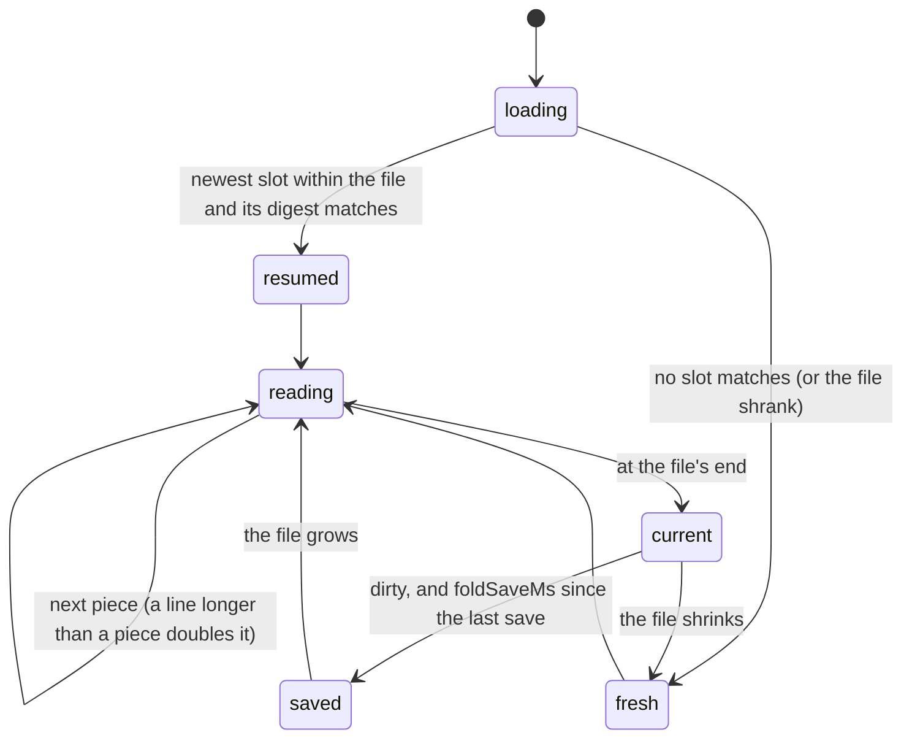

# SM5 A fold read on from its save, one reader and one saver

## Now

Three folds (main transcript, agent files, inboxes) go through the same
life, each written out apart:

| Step | Main (`transcripts.ts`) | Agent (`transcripts.ts`) | Inbox (`inbox.ts`) |
| --- | --- | --- | --- |
| load | `loadFold` `:161` | `savedFold` `:477` | `loadKept` `:107`, `unchecked` per entry |
| piece loop | `foldOf` `:88`–`:103` | `foldAgentPieces` `:452` | `readOn` `:144`–`:160` |
| throttled save | `saveMainFold` `:201` | `saveFold` `:503` | `save` `:180` |
| save state | `savedAt`, `savedTo`, `mark` | `foldSaved` map `:496` | `seq`, `dirty`, `savedAt` |

The piece loop (read up to the last newline, double on a line longer than
a piece) is written three times; the two-slot save (`(seq + 1) % 2`,
throttled by `CONFIG.foldSaveMs`, logged on failure) twice.

## Target

- `hooks/fold_io.ts`: `readWholeLines($, path, from, size, fold)`, the
  one piece loop; `slotSaver(dir, slots)`, the one throttled two-slot
  writer, with `{ seq, dirty, savedAt }` as its state.
- Main keeps its head-and-parts save, through the same throttle.
- The file names, slot order and contents are unchanged.

## Tests

`fold-saves.json`, `inbox_fold.test.ts`, `agent_fold.test.ts` and the
`band.test.ts` reload cases pass unchanged. New: a piece-loop table
(empty, one line, a line longer than a piece, a trailing partial line)
over an in-memory reader.
