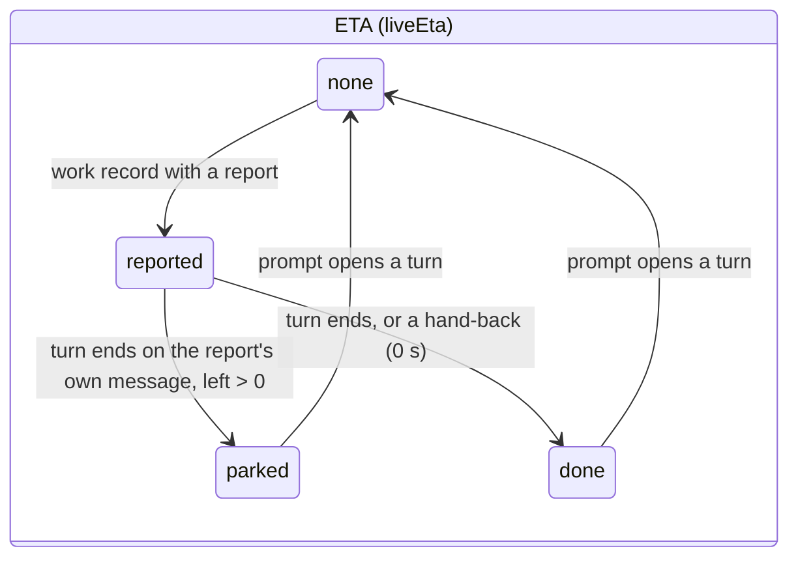

# SM2 The fold states as named records with pure transitions

## Now

Three per-thread machines ride inside the transcript and agent folds as
positional tuples, changed in place:

| Tuple (`claude_records.ts`) | Fields by index | Transition |
| --- | --- | --- |
| `EtaState` `:1243` | report, answer done, last epoch, report's message id | `liveEta` `:1270` |
| `SpanState` `:1294` | opened at, last work (both null between spans) | `agentSpan` `:1303`, `closeAgentSpan` `:1320` |
| `TurnGate` `:1469` | open turn's index, answer ended, turnPosition seen, in flight | `turnOpens` `:1537`, after `inFlightAfter` `:1494` |

`TurnGate` holds four flags whose sixteen combinations the code reads as
about five states (idle, prompt in, answer in flight, answer between
requests, answer ended), and `turnOpens` reads and writes it by index.
`main_fold.ts:178`–`:197` and `agent_fold.ts:50`–`:79` copy each tuple
out field by field to save it, and `claude_records.ts:1827` to clone it.

## Target

- `type EtaState = { report: EtaReport | null; done: boolean; at: number
  | null; mid: unknown }`, `type Span = { kind: "closed" } | { kind:
  "open"; from: number; last: number }`, and `TurnGate` as `{ index;
  phase: "idle" | "answering" | "between" | "ended"; seen }`.
- Each transition returns the next state: `liveEta(state, r, opens):
  EtaState`, `agentSpan(span, r): [Span, Span[]]`, `turnOpens(gate, r):
  [GateState, string | null]`. The folds keep the returned value.
- The save formats are unchanged: `main_fold.ts` and `agent_fold.ts`
  write each record through an explicit codec to the arrays they write
  today, so `fold-saves.json` and every saved fold read back as before.

## Tests

`claude_records.test.ts`'s `liveEta`, `agentSpan` and `turnOpens` cases
become (state, record) → state tables, with a row per transition in the
diagram. `fold-saves.json` and the `main_fold`/`agent_fold` suites pass
unchanged.
