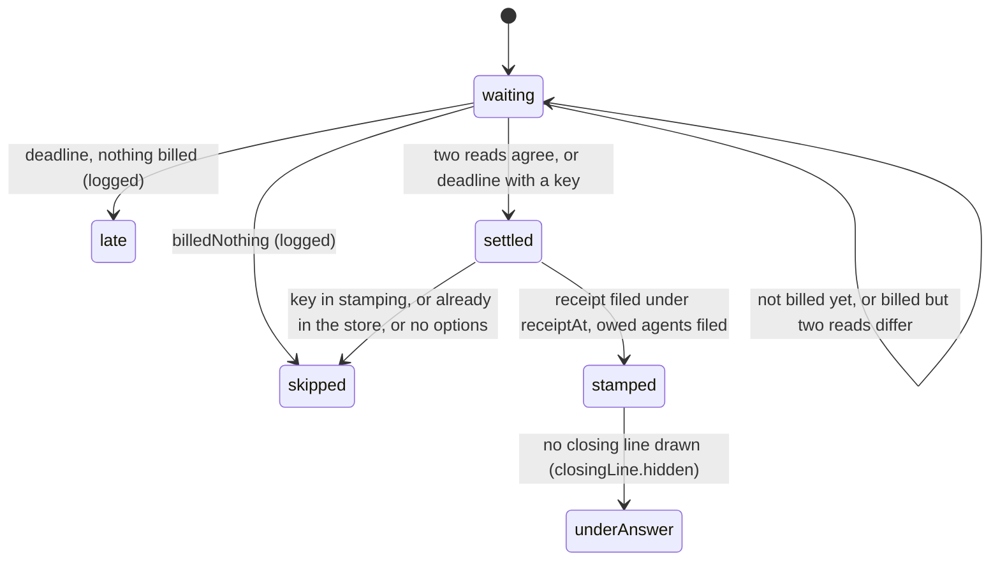

# SM4 A turn's receipt: the stamp's decisions as a pure step

Changes behaviour: the owed list moves to an index of its own.

## Now

`stamp` (`register.tsx:564`–`:650`) polls the transcript and decides
inline, then files the receipt; `underAnswer` (`:529`) and `stampMissed`
(`:661`) poll for the closing line.

The states are the loop's locals (`last`, `got`, `late`), the in-memory
`stamping` set (`:501`) and four store-key families: `receipt:`
(`:490`), `receipt-owed:` (`:496`), `receipt-at:` (`:506`),
`receipt-answer:` (`:510`). The owed agents are a second machine (owed →
stamped on the first receipt after they end), kept by `stampedSplit`
(`band_tree.ts`).

## Problems

- The decisions (`newestBilled`, `billedNothing`, the two-read rule, the
  deadline) are only reachable through the engine: no test drives
  `stamp`.
- `receipt-owed:` is filed through `remember` under the `receipts`
  index, so it ages out with the receipts it is not one of.

## Target

- `stampStep(turns, prompt, end, last, late): { kind: "wait"; key } | {
  kind: "skip"; why } | { kind: "stamp"; key }` in `src/receipt.ts`,
  pure; `stamp` is the loop that calls it, sleeps and files.
- The owed list kept apart from the receipts' index (below).

## Tests

A table over turns fixtures: not billed, billed once, billed twice
alike, billed nothing (each reason), deadline with and without a key.
`receipt_closing.test.ts` unchanged.

## Waits for

"Pack receipts in the mod's store and keep fewer of them" (branch
`store-receipts-compact`, 2b310ff), which rewrites `remember` and the
receipt's stored shape; this node is written against it.

## The owed list

`receipt-owed:` keys move out of the `receipts` index into an index of
their own, so each index holds one kind of key. A store written before
the change has its `receipt-owed:` keys moved across when it is loaded,
and a test seeds such a store.
