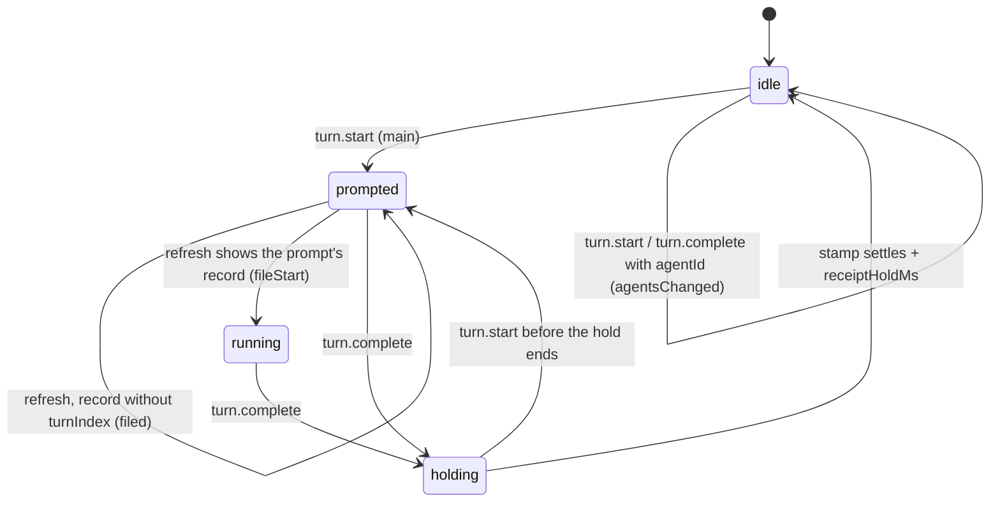

# SM3 The main thread's turn and the session, as the hooks see them

## Now

The hooks keep the turn in four places, set by hand in each handler:

| State | Where (`register.tsx`) |
| --- | --- |
| `turnRunning` | module `let`, `:200` |
| `held` | atom, `:86` |
| `pending` `{text, before, filed?}` | module `let`, `:223` |
| `opened` (promptId, `""` for none) | module `let`, `:229` |

Set in `turn.start` (`:906`–`:920`), `turn.complete` (`:930`–`:965`),
`fileStart` (`:318`–`:338`), `forgetSession` (`:428`–`:441`); read by
`tick` (`:359`) for its pace and by `bandNow` (`:833`) and the
`PromptHint` render (`:1168`) as `isWorking || held`.

The session around it is a second machine: `startedFor` (`:387`),
`generation` (atom `:78`), the tick and clock loops (`:349`, `:368`)
stopping when the generation moves, and `forgetSession` on a switch.

## Problems

- Sixteen combinations of `turnRunning` × `held` × `pending` × `opened`
  for five states; nothing stops `turnRunning` with `pending === null`
  and `opened === ""` after a `/resume` mid-turn.
- A `turn.start` during a hold sets `held` false (`:914`), and the
  earlier stamp's `finally` (`:962`) sets it false again later: harmless
  today, unrepresented in any type.
- No test drives the handlers' sequencing: `fileStart` has none.

## Target

- `hooks/turn_life.ts`, pure: `type TurnLife = { kind: "idle" } | { kind:
  "prompted"; text; before; filed? } | { kind: "running"; prompt } | {
  kind: "holding"; prompt; until }` and `nextTurn(life, event)` over
  `turn-start`, `prompt-seen`, `turn-complete`, `hold-ended`,
  `session-switched`.
- `register.tsx` keeps one `let life: TurnLife` and derives
  `turnRunning`, `held` and the receipt's prompt from it; `held` stays an
  atom only as the draw trigger, written from `life`.

## Tests

A table in `mod-tests/` of (life, event) → life covering every arrow
above, and `fileStart`'s filed-then-overwritten case. `band.test.ts`
and the live cases are unchanged.
